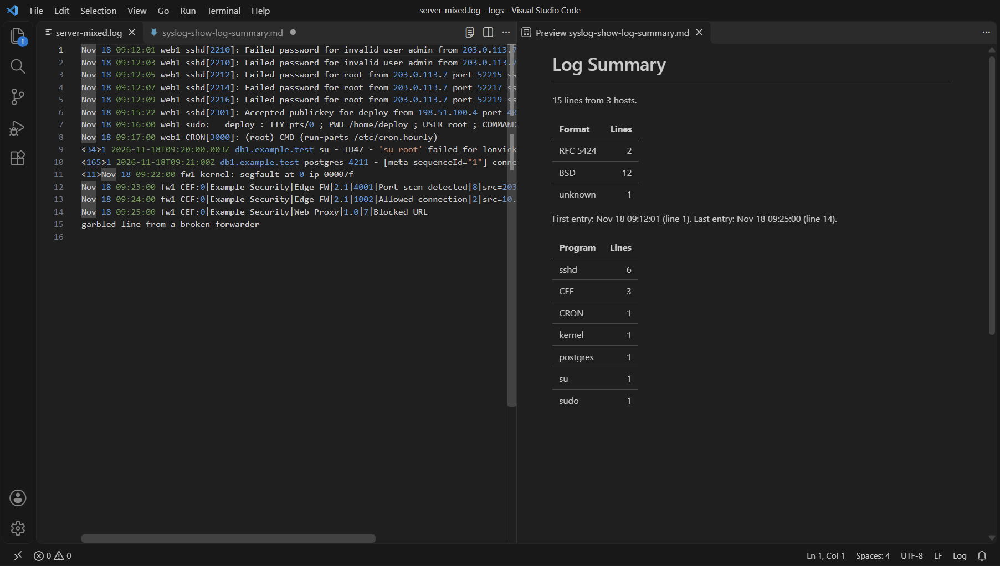
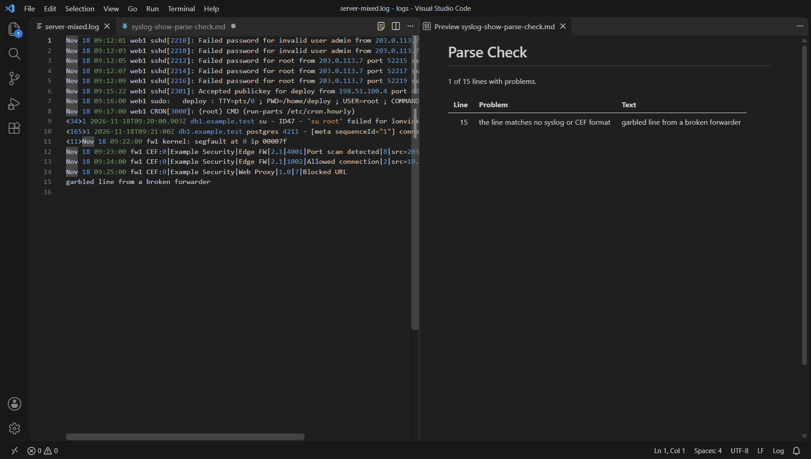
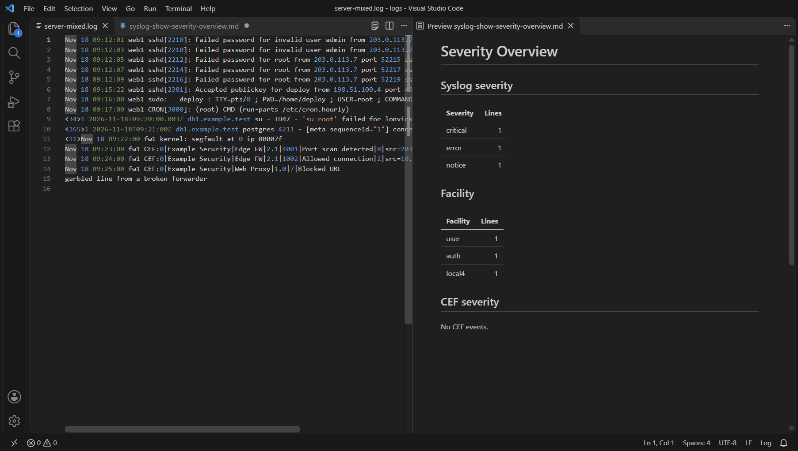
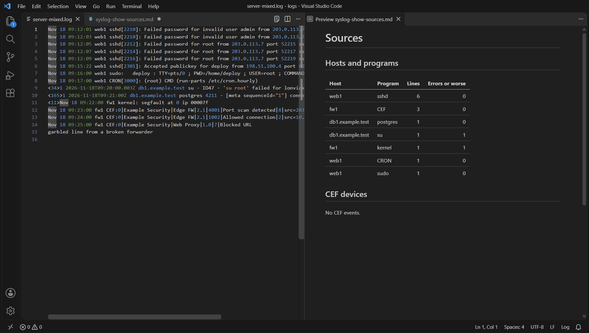
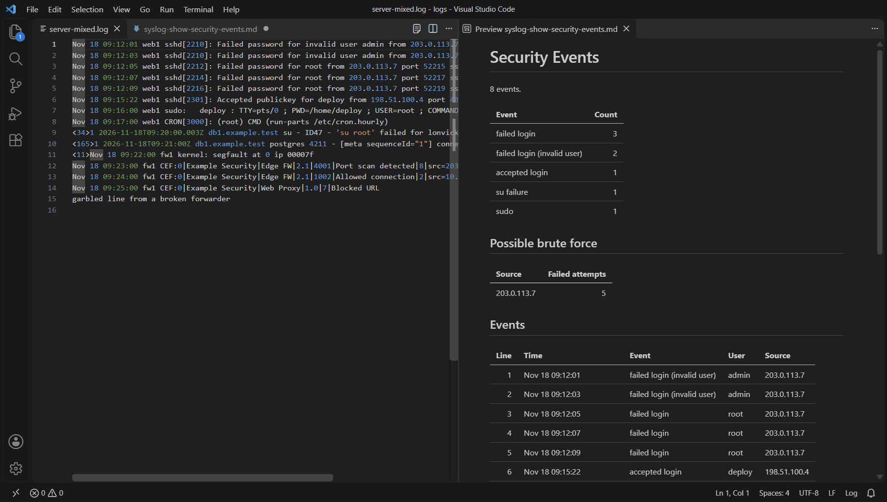

# Syslog Atlas

Syslog Atlas reads syslog files (RFC 5424, BSD syslog and the usual /var/log layout) and CEF events and turns them into clear Markdown reports: the formats, hosts, time range and busiest programs, the lines that do not parse, the severities and facilities, the hosts, programs and CEF devices that log the most, and security events such as failed and accepted logins, sudo, su failures and possible brute force sources.

Everything runs on your computer. There is no telemetry. The only network request the extension ever makes is the licence check for the optional Pro tier (see [Privacy](PRIVACY.md)).

## What it does

* **Show Log Summary**: The log at a glance: lines per format, hosts, first and last entry, and the busiest programs.
* **Show Parse Check**: Lines that match no syslog or CEF format, invalid PRI values and malformed CEF headers.
* **Show Severity Overview**: Lines per syslog severity and facility, and CEF events per severity.
* **Show Sources** (Pro): Hosts and programs with their line counts and errors, CEF devices and the top CEF signatures.
* **Show Security Events** (Pro): Failed and accepted logins, sudo and su, high-severity CEF events, and possible brute force sources.

## Free, trial and Pro

| Feature | Free | Pro |
| --- | :---: | :---: |
| Show Log Summary | yes | yes |
| Show Parse Check | yes | yes |
| Show Severity Overview | yes | yes |
| Show Sources |  | yes |
| Show Security Events |  | yes |
| Open Sample File, walkthrough, Report A Problem | yes | yes |

The free reports need no key, no account and no network connection, and they will not be moved behind the licence key later. The first Pro command starts a **free 14-day trial** on this computer. After that, Pro is a one-time purchase, not a subscription: **Pro Personal USD 19** (one person, use at work allowed) or **Pro Business USD 39 per user** (one key per user of an organisation). A key works on up to 3 computers. The checkout page shows the final price and any taxes for your country. Licence keys are sold by Dodo Payments, the merchant of record. Details: [licence](docs/licence.md), [terms](TERMS.md).

## Commands

Open the Command Palette and type `Syslog Atlas`.

| Command | Tier |
| --- | :---: |
| Syslog Atlas: Show Log Summary | Free |
| Syslog Atlas: Show Parse Check | Free |
| Syslog Atlas: Show Severity Overview | Free |
| Syslog Atlas: Show Sources | Pro |
| Syslog Atlas: Show Security Events | Pro |
| Syslog Atlas: Open Sample File | Free |
| Syslog Atlas: Open Walkthrough | Free |
| Syslog Atlas: Show Documentation | Free |
| Syslog Atlas: Report A Problem | Free |
| Syslog Atlas: Buy Pro | Free |
| Syslog Atlas: Enter Licence Key | Free |
| Syslog Atlas: Show Licence Status | Free |
| Syslog Atlas: Remove Licence From This Machine | Free |

## Settings

| Setting | Default | Meaning |
| --- | --- | --- |
| `syslogAtlas.maxFileSizeMB` | 50 | Largest file a report reads (0.1 to 50 MB; VS Code passes files only up to 50 MB to extensions). |
| `syslogAtlas.openReportsAsPreview` | true | Open each report in the Markdown preview as well. |

## FAQ

**Does Syslog Atlas upload my logs?**
No. Every report is created on your computer from the text in the editor, and nothing is sent anywhere.

**Which security events does it recognise?**
Failed and accepted SSH logins (password, public key, keyboard-interactive), invalid users, sudo commands, PAM authentication failures, su failures, and CEF events with severity 7 or higher. Sources with 5 or more failed attempts are listed as possible brute force.

**Why does the year not appear?**
BSD syslog timestamps have no year. Syslog Atlas shows timestamps as they are written and gives the first and last entry in file order.

**Can it read very large logs?**
Yes, up to the 50 MB VS Code passes to extensions; tables are cut at 500 rows and say how many rows there are.

## For IT and procurement

* Publisher: SmallStepsStudio (Visual Studio Marketplace), smallstepsstudio (Open VSX).
* Network: one host, `live.dodopayments.com`, for the licence check only, and only after a key is entered. No telemetry. The trial uses no network.
* Files are read from the editor only; the extension writes no files and changes none.
* Source: <https://github.com/small-steps-studio/syslog-atlas>.
* Licence agreement: [LICENSE.txt](LICENSE.txt). Terms: [TERMS.md](TERMS.md). Privacy: [PRIVACY.md](PRIVACY.md).

## Support

Run **Syslog Atlas: Report A Problem** or open an issue at <https://github.com/small-steps-studio/syslog-atlas/issues>. Never post a licence key or confidential data in a public issue.

CEF (Common Event Format) is a format of OpenText (formerly ArcSight); Syslog Atlas is an independent product and is not affiliated with or endorsed by OpenText.
